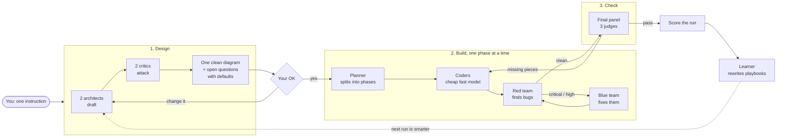
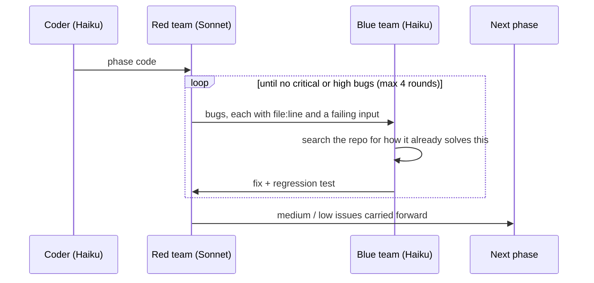
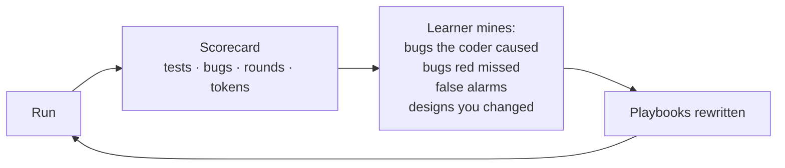
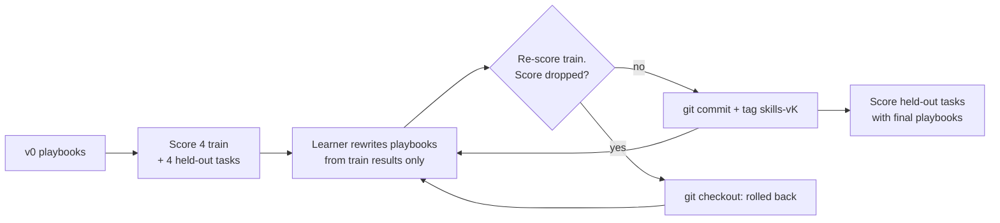

<div align="center">

# 🧙 mudbloods

### An AI build team in one skill, and it gets better every time it runs.

You type one line. It designs the change, asks for your OK, writes the code
phase by phase, attacks its own code, fixes what it finds, checks the result
against what you asked for, and then **rewrites its own playbooks** so the
next run makes fewer mistakes.

`/mudbloods build a calculator CLI with history`

**Claude Code** · **TrueForge** · **any agent that reads `SKILL.md`**

</div>

---

## Contents

1. [Install and run it anywhere](#1-install-and-run-it-anywhere)
2. [What it does](#2-what-it-does)
3. [How to get a task done](#3-how-to-get-a-task-done)
4. [The recipe book: every command](#4-the-recipe-book-every-command)
5. [Examples](#5-examples)
6. [Proof: it gets better, and the number is honest](#6-proof-it-gets-better-and-the-number-is-honest)
7. [What's in the repo](#7-whats-in-the-repo)

---

## 1. Install and run it anywhere

mudbloods is plain markdown: one `SKILL.md`, flow files, playbooks and agent
definitions. Any agent that can read files and run a shell can use it.

### Claude Code (plugin, recommended)

Inside Claude Code:

```
/plugin marketplace add M-SriVidya/mudbloods
/plugin install mudbloods@mudbloods
```

Restart Claude Code, open any project, and run:

```
/mudbloods build <what you want>
```

You also get one shortcut per command: `/mudbloods:build`, `/mudbloods:review`
and so on.

### TrueForge

mudbloods uses the same skill format as TrueForge: a folder in a git repo,
rooted at `SKILL.md`, with `name` and `description` frontmatter.

1. Start TrueForge: `npx @truefoundry/trueforge@latest`.
2. Open **Settings → Skills**, add a GitHub repository, and enter:

   | Field | Value |
   |---|---|
   | Repository | `https://github.com/M-SriVidya/mudbloods` |
   | Path | `mudbloods/skills/mudbloods` |
   | Ref | `main`, or pin a commit SHA |

3. In **Build Agent**, enable the **sandbox** (TrueForge skills need it).
   Then add the `mudbloods` skill and keep **dynamic sub-agents** on.
4. Chat with the agent: `/mudbloods build <what you want>`.

On TrueForge, mudbloods uses three of the platform's building blocks:

| TrueForge feature | Used for |
|---|---|
| **Skills** | mudbloods itself: `SKILL.md`, flows and playbooks |
| **Sub-agents** | architects, critics, coders, red team, blue team, judges, learner |
| **Sandbox** | where the code is written, tests run and playbooks get rewritten |

The pipeline, the review loops and the learning work the same way as in
Claude Code.

### Any other agent (Codex, Cursor, Gemini CLI, your own harness)

1. Clone the repo:
   ```
   git clone https://github.com/M-SriVidya/mudbloods
   ```
2. Put `mudbloods/skills/mudbloods/` where your tool loads skills. If your
   tool has no skills folder, add this line to its instructions file
   (`AGENTS.md`, `.cursorrules`, `GEMINI.md`, system prompt):
   ```
   When the user types "/mudbloods ...", read <path>/mudbloods/skills/mudbloods/SKILL.md and follow it exactly.
   ```
3. Optional: register the role prompts in `mudbloods/agents/` as subagents.
   - **No named subagents?** mudbloods uses generic ones with the same prompts.
   - **No subagents at all?** The main agent plays each role in turn.

### Claude Code, bare `/mudbloods` without a plugin

```
git clone https://github.com/M-SriVidya/mudbloods
node mudbloods/mudbloods/install.mjs
```

---

## 2. What it does

### The problem

Coding agents write code fast, but they:

- build the wrong thing because nobody agreed on the design first,
- ship bugs because the same model that wrote the code also says it's fine,
- burn expensive tokens on boilerplate,
- repeat the **same mistakes** next week, because they learn nothing.

### The fix: a small team with one job each, and a memory



### Who does what

| Role | Model | Job |
|---|---|---|
| Architect ×2 | Opus | Read the repo, draft the design: one minimal, one clean |
| Critic ×2 | Sonnet | Attack the drafts: wrong fit for the repo, vague arrows, missing error paths |
| Planner | Opus | Split the design into 1–6 phases of small, exact tasks |
| Coder | **Haiku** | Write the code for one phase, following repo patterns |
| Red team ×2 | Sonnet | Try to break the code, with a failing input as proof |
| Blue team | **Haiku** | Fix the bugs by copying how the repo already handles that kind of problem |
| Judge ×3 | Opus | Final panel: does it match the design, pass the criteria, and do what you meant? |
| Learner | Sonnet | Turn this run's mistakes into rules for the next run |

Thinking runs on strong models. All code writing runs on Haiku. If Haiku
fails the same fix twice, that fix goes to Sonnet, and the learner writes the
recipe down so Haiku can handle it next time.

### The red team / blue team loop



| Severity | Blocks the phase? | Example |
|---|---|---|
| critical | yes | security hole, data loss, build broken |
| high | yes | wrong result on normal input, a criterion not met |
| medium | no, carried forward | crash on an empty list, resource leak |
| low | no, carried forward | duplicated helper, unclear name |

### How it gets better every run



Every agent reads a **playbook** before it starts. The learner edits those
playbooks after each run. Every rule records where it came from, so a bad
rule can be traced and removed.

```
- [error-handling] Map DB unique-violation to 409, as in src/api/orgs.ts:58. (from run 20261031-1200, bug P2-R1-F3, seen 2x)
```

| Playbook layer | Where | Learns |
|---|---|---|
| Seed | inside the skill | Rules proven across repos (`learn --promote`, with your OK) |
| You | `~/.claude/mudbloods/playbooks/` | Your habits across all projects |
| This repo | `.mudbloods/playbooks/` | This codebase's conventions, with `file:line` examples |

Rules that never prove useful are deleted. Only playbooks learn. The pipeline
itself changes only by hand, so it can't drift.

### What you can ask it for

- **New features:** "add email invites to the settings page".
- **Whole small apps:** "build a calculator CLI with history".
- **Code review:** any PR, branch, folder or uncommitted change.
- **Just the design:** a diagram to argue over before anyone writes code.
- **A health check:** does what got built match what was asked?

---

## 3. How to get a task done

```
/mudbloods build <what you want, in plain words>
```

That's it. Here is what happens next:

1. **You get a design.** A diagram, a list of components, the acceptance
   criteria, and open questions. Each question comes with a default answer.
2. **You answer once.** Say "yes", change a default ("use SQLite, not
   Postgres"), or ask for changes. Nothing is coded until you clearly say
   yes.
3. **It builds.** You see one line per phase and per review round:
   ```
   P2 round 1: 0 critical, 2 high, 3 medium -> blue fixing 2
   P2 round 2: 0 critical, 0 high, 1 medium -> clean
   ```
4. **You get a report:**
   ```
   mudbloods build: pass
   phases: 3   review rounds: 5   repair cycles: 0
   code: +640 -38 across 11 files
   findings: 0 critical, 4 high fixed | 4 medium, 3 low open (see carry.md)
   acceptance: 14/14
   score: 86.2 (prev 79.4)
   learned: 3 new rules, 1 pruned -> playbook seed+5
   ```

Want to skip the questions? Add `--auto` and it takes every default.

Everything is saved in `.mudbloods/` in your project. You can stop at any
point and pick up later with the matching command.

---

## 4. The recipe book: every command

| Command | What it does | When to use it |
|---|---|---|
| `/mudbloods build <instruction>` | The whole pipeline: design, your OK, plan, code, review, judge, learn | Most of the time |
| `/mudbloods architecture <instruction>` | Design plus open questions, then stops after your OK | Agree on the shape before any code |
| `/mudbloods plan` | Splits the approved design into phases | After `architecture` |
| `/mudbloods code [phase]` | Builds one phase and runs its red/blue loop | Step through phase by phase |
| `/mudbloods review [PR / branch / path]` | Red team review of any code; `--fix` adds the blue team | Code mudbloods didn't write |
| `/mudbloods judge` | Final panel: does the result match the design and criteria? | After building, or on your own work |
| `/mudbloods learn [--promote]` | Turns the last run's mistakes into playbook rules | Runs automatically after `build` |
| `/mudbloods bench` | Runs the gated learning loop on the fixed tasks (asks before spending) | Prove it improved |
| `/mudbloods status` | Where the run is, open bugs, score trend | Any time |

| Flag | Effect |
|---|---|
| `--auto` | Accept every default and skip the sign-off wait |
| `--phases N` | Use at most N phases |
| `--no-learn` | Don't update playbooks after this run |
| `--fix` | (review) Also fix the critical and high findings |
| `--comment` | (review) Post findings on the PR, after asking you |

In the Claude Code plugin, each command also has a shortcut:
`/mudbloods:build`, `/mudbloods:review`, `/mudbloods:status` and so on.

---

## 5. Examples

### Build something end to end

```
/mudbloods build calculator
```

1. **Design.** It reads your repo and shows a diagram: input parser,
   evaluator, CLI loop, error handling, tests. It asks a few questions with
   defaults:
   - *Operator precedence and brackets?* Default: yes.
   - *Divide by zero?* Default: show an error and keep running.
   - *Keep history?* Default: no.
2. **You say "yes, and add history".** It updates the design and shows you
   only the parts that changed.
3. **Build.** Three phases: tokenizer and parser, then evaluator, then CLI
   and history. Each phase goes through red team and blue team.
4. **Judge.** Three judges run every acceptance criterion and pass the build.
5. **Report** with lines of code, bugs fixed, and score. The learner saves
   what went wrong, such as "parser ignored a unary minus", as a rule for
   next time.

### Review a pull request

```
/mudbloods review 42
```

Two red-team agents read PR #42: one hunts correctness and security bugs,
the other hunts integration and edge-case bugs. You get one line per bug:

```
src/api/users.ts:42 [high/error-handling] Duplicate email returns 200 with no body. Map it to 409 like src/api/orgs.ts:58.
src/api/users.ts:77 [medium/test-gap] Test mocks the function it is testing, so it can't fail.
```

Add `--fix` and the blue team fixes every critical and high bug, with a
regression test for each. Add `--comment` to post the findings on the PR.
It asks you first.

### Design only

```
/mudbloods architecture move auth from sessions to JWT
```

You get the diagram, the components, the risks and the open questions, and
no code. Good for team discussions.

### Step by step

```
/mudbloods plan
/mudbloods code P1
/mudbloods code P2
/mudbloods judge
/mudbloods status
```

### Check that it's learning

```
/mudbloods learn
/mudbloods status
```
```
playbook: seed+5 (repo 3 rules, user 2 rules)
scores: 61 -> 68 -> 74 (last 3 runs)
```

---

## 6. Proof: it gets better, and the number is honest

The TrueForge rule for this track: *a later run on the same fixed tasks beats
run 1, using skills the agent rewrote.* This is how mudbloods meets it.



### Fixed tasks with hidden tests

8 small tasks with 80 hidden tests. Agents build in an empty throwaway repo
and never see the tests.

| Train (the learner sees these results) | Held-out (it never does) |
|---|---|
| `01-slugify`: URL slugs, accents, max length | `03-wordcount-cli`: CLI, stdin, `--top`, `--json`, exit codes |
| `02-lru-cache`: eviction order, TTL, injected clock | `06-rate-limiter`: token bucket, per-key limits |
| `04-calculator`: precedence, unary minus, errors | `07-url-shortener`: aliases, collisions, hit counts |
| `05-csv-parser`: RFC 4180 quoting, headers | `08-semver`: SemVer 2.0 ordering, `^` and `~` ranges |

Every hidden test passes against a hand-written reference solution, so a low
score means the agent failed, not the test:

```
node bench/verify-tests.mjs        # 8 suites, 80/80
```

### The score: no AI grading itself

| Part | Points | Source |
|---|---|---|
| Hidden tests passed | 70 | `node --test`, outside the agent |
| Critical and high bugs the red team had to catch | 15 | counted from `findings.jsonl` |
| Cost | 15 | Claude Code's own usage report, all models and subagents |

```
score = 70 * passed/total + 15 * max(0, 1 - (high + 2*critical)/10) + 15 * min(1, $2.00 / cost)
```

### What it learns from

| Signal | Comes from | Rewrites |
|---|---|---|
| Bugs the red team caught | `findings.jsonl` | Coder playbook: a rule that stops the bug |
| Bugs the red team **missed** | hidden tests that failed on train tasks | Red-team checklist: a new check. Coder: a new rule |
| False alarms | red-team findings the blue team disproved | Red-team checklist: "don't flag X when Y" |
| Fixes Haiku couldn't make | findings escalated to Sonnet | Blue-team playbook: a step-by-step recipe |
| Rejected rewrites | earlier rollbacks | Never proposed again |

Rules must describe the bug class, never the task. A rule like "handle unary
minus after an operator" is allowed. A rule that names `calc.js` is not. That
is why the held-out score matters: rules that only memorise the train tasks
don't help there.

Dead rules are pruned: a rule whose bug class has stopped appearing for 2
versions is deleted, and the gate keeps the deletion only if the score holds.

### Run it

```
node bench/evolve.mjs --iterations 2      # v0, learn, gate, learn, gate, held-out
node bench/report.mjs                     # bench/REPORT.md + bench/chart.svg
git diff skills-v0 skills-v2 -- mudbloods/skills/mudbloods/playbooks
```

`bench/chart.svg` plots train score, held-out score and cost per task for each
version. Each version's evidence, playbook diff and `lessons.md` are kept in
`bench/artifacts/`.

A full run calls `claude -p` for every task, about 20 full builds for two
iterations, so it costs real money. To check the harness first for free:

```
MB_DRYRUN=1 node bench/evolve.mjs         # fake builds, real git, gate and report
MB_DRYRUN=1 MB_DRYRUN_BAD=2 node bench/evolve.mjs --iterations 3   # see a rollback
```

Run dry runs in a scratch clone: they commit and tag like real runs.

Bench runs load the skill from this repo (`--plugin-dir`) and ignore your
user settings and plugins, so every version sees only the playbooks in git.
By default the agents get `acceptEdits` plus a fixed tool allowlist. Setting
`MB_PERMISSION=bypass` removes the allowlist; only do that in a container or
VM.

---

## 7. What's in the repo

```
.claude-plugin/marketplace.json     Claude Code marketplace entry
mudbloods/
  .claude-plugin/plugin.json        plugin manifest
  commands/                         /mudbloods:<verb> shortcuts
  agents/                           8 role prompts (architect ... learner)
  install.mjs                       bare /mudbloods install for Claude Code
  skills/mudbloods/                 ← the skill (point TrueForge here)
    SKILL.md                        command router + rules for every flow
    flows/                          one file per command, loaded only when used
    reference/                      roles, severity scale, saved state, playbook layers
    playbooks/                      seed playbooks: the part that learns (versioned, tagged)
bench/                              outside the plugin, so agents can't read it
  tasks/ + tasks.json               8 tasks, 80 hidden tests, train / held-out split
  reference/                        hand-written solutions that prove the tests are fair
  run.mjs  score.mjs                run tasks, deterministic score
  evolve.mjs                        learn, gate, commit or roll back, held-out check
  report.mjs                        REPORT.md + chart.svg
```

<div align="center">

Built by **team Mudbloods** for the TrueForge *Build a Self-Improving Agent*
track. MIT licensed.

</div>
