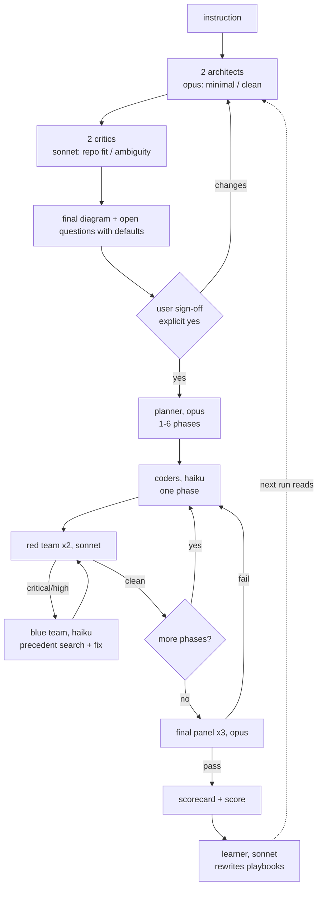

# mudbloods

An agent that builds software the way a careful team does, then rewrites its
own playbooks so the next run is better. Built by team Mudbloods for the
TrueForge "Build a self-improving agent" track.

```
/mudbloods build add email invites to the org settings page
```

## What one `build` does



## Commands

| Command | Does |
|---|---|
| `/mudbloods build <instruction>` | Everything above, end to end |
| `/mudbloods architecture <instruction>` | Architecture diagram, open questions, sign-off. Stops there |
| `/mudbloods plan` | Phases from the approved architecture |
| `/mudbloods code [phase]` | Build one phase and run its red/blue loop |
| `/mudbloods review [PR# / branch / path]` | Red/blue review of any code; `--fix`, `--comment` |
| `/mudbloods judge` | Final panel against architecture and acceptance criteria |
| `/mudbloods learn [--promote]` | Mine the last run, rewrite playbooks |
| `/mudbloods bench` | Fixed tasks, hidden tests, fixed score |
| `/mudbloods status` | Run state, open findings, playbook version, score trend |

Flags: `--auto` (take all defaults, no sign-off wait), `--phases N`, `--no-learn`.

## Model split

Thinking (architect, critic, planner, red team, judge, learner) runs on Opus
or Sonnet. Code writing (coder, blue team) runs on Haiku only. A finding the
Haiku blue team fails twice escalates to Sonnet, and the learner turns that
escalation into a recipe so Haiku can handle it next time.

## How it improves itself

| TrueForge asks | mudbloods does |
|---|---|
| Scores itself | Every run writes `scorecard.json`; `bench/score.mjs` turns it into a 0-100 score from hidden tests, judge verdict, bugs introduced, first-round-clean phases and tokens |
| Rewrites its own skills | `learn` rewrites the playbooks every agent reads before acting; `learn --promote` writes proven rules back into this skill's own `playbooks/` |
| Fixed tasks, fixed scorer | `skills/mudbloods/bench/tasks/` (3 tasks, 30 hidden tests) and `bench/score.mjs` |
| Later run beats run 1 | `node bench/run.mjs`, learn, run again, `node bench/score.mjs --compare` |
| Code reviewer that sharpens its checklist | Red-team playbook gains a check every time the judge catches what red missed, and loses one when its findings get rejected |
| Same quality, fewer tokens | Tokens are a scored term; Haiku does all code writing; planner rules learn to make tasks Haiku can finish in one round |

Learning signals: fixed critical/high bugs, repeated categories, escalations,
rejected findings, judge failures red missed, architecture revisions, and
defaults the user changed. For each bug class the learner also searches how
the repo already handles it and writes that precedent (`path:line`) into the
repo-layer coder playbook.

Playbooks layer seed, then user (`~/.claude/mudbloods/playbooks/`), then repo
(`.mudbloods/playbooks/`). Every learned rule carries its run and finding id,
and unproven rules are pruned. Only playbooks learn: `SKILL.md` and `flows/`
change only by hand.

## Install

As a user skill (gives bare `/mudbloods`):

```
node mudbloods/install.mjs
```

As a plugin (gives `/mudbloods:build`, `/mudbloods:review`, ... and `/mudbloods:mudbloods <verb>`):

```
/plugin marketplace add M-SriVidya/mudbloods
/plugin install mudbloods@mudbloods
```

## Bench

```
node mudbloods/skills/mudbloods/bench/run.mjs
node mudbloods/skills/mudbloods/bench/score.mjs --compare
```

`run.mjs` runs `claude -p` with `--permission-mode acceptEdits` by default, in
a fresh temp git repo per task. Set `MB_CLAUDE_ARGS` to change that, and
`MB_COMMAND=/mudbloods:mudbloods` for plugin installs. The hidden tests live
in the skill folder, outside the workspace. The agents could still read them
if they went looking, so treat bench scores as honest-effort, not adversarial.

## Layout

```
mudbloods/
  .claude-plugin/plugin.json
  agents/                 8 subagents (mb-architect ... mb-learner)
  install.mjs
  skills/mudbloods/
    SKILL.md              router + global rules
    flows/                one file per verb, loaded on demand
    reference/            agents, severity, state, playbook layering
    playbooks/            seed playbooks (the part that learns)
    bench/                fixed tasks, hidden tests, runner, scorer
```
